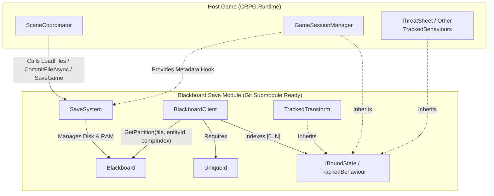

# Requirements

### Overview & Goals
Currently, `Blackboard` stores state in a 3-level dictionary structure:
`fileName -> entityId -> variableName -> value`

Because `BlackboardClient` retrieves a single `Partition` (`Dictionary<string, object>`) for the entire `GameObject` (`entityId`) and passes that same dictionary to every `IBoundState` component on the `GameObject`, two components on the same entity that define a `Tracked<T>` variable (or manual state key) with the same name will overwrite each other's values.

This plan covers the completed 4-level component hierarchy & submodule extraction (Stages 1–4) and extends the architecture with **Reference-Counted File Management (`BlackboardScope`)** and **Hollow Signal's Unified Scene Offloading & Loading-Screen Pipeline** (Stages 5–7):

1. **Isolate Component State via Component Order Index (Completed)**: Expand the `Blackboard` hierarchy to 4 levels:
   `fileName -> entityId -> componentId -> variableName -> value`
   where `componentId` is derived from the component's order index in `GetComponents<IBoundState>()` (`"0"`, `"1"`, `"2"`).
2. **Prepare the Blackboard Save Module for Git Submodule Extraction (Completed)**: Decouple the RAII save system (`Blackboard`, `SaveSystem`, `BlackboardClient`, `TrackedBehaviour`, `TrackedTransform`, `UniqueId`, and `SaveSystemEditor`) into `Assets/ImportedToolsAndLibraries/BlackboardSaveSystem/` with dedicated `.asmdef` files.
3. **Reference-Counted File Lifecycle & `BlackboardScope` RAII Component**:
   - Track per-file reference counts (`_refCounts`) in `Blackboard` so that:
     - Loading/acquiring an already-loaded file (`refCount > 1`) increments its reference count without re-reading disk or overwriting live in-memory state.
     - Unloading/releasing a file decrements its reference count and only serializes to `_active_session/<fileName>.json` and removes it from RAM when `refCount` reaches `0`.
   - Provide a scene-agnostic `BlackboardScope` MonoBehaviour in `BlackboardSaveSystem.Runtime` that acquires its configured `fileNames` on `OnEnable()` and releases them on `OnDisable()`.
   - Enforce script execution order (`SaveSystem` at `-1100`, `BlackboardScope` at `-1000`, `BlackboardClient` at `0`) both via `[DefaultExecutionOrder]` attributes in code and via an automatic `[InitializeOnLoad]` `MonoImporter` check in `BlackboardSaveSystem.Editor`.
4. **Hollow Signal Scene Offloading Order & Loading Screen Pipeline (`SceneCoordinator`)**:
   - Keep loading screen curtains, scene transitions, and scene teardown order strictly inside Hollow Signal (`SceneCoordinator`), leaving the `BlackboardSaveSystem` submodule 100% scene-agnostic.
   - Implement controlled scene offloading in `SceneCoordinator` so that when a scene unloads, all `BlackboardClient` components flush and disable **first**, and any `BlackboardScope` components disable and release their files **last** before the scene is unloaded.
   - Unify the loading screen transition flow (`FadeIn` $\rightarrow$ offload old scene / acquire new files $\rightarrow$ load scene & hydrate entities $\rightarrow$ `FadeOut`).

---

### Scope

#### In Scope
- Refactoring `Blackboard` in-memory containers, lookup helpers, and JSON serialization/deserialization to support `fileName -> entityId -> componentId -> variableName -> value`.
- Updating `BlackboardClient` to index its `_boundStates` array and pass the component-specific `Partition` to each `IBoundState` during `OnLoadState` and `OnSaveState`.
- Decoupling `SaveSystem` from `GameSessionManager` and `SceneCoordinator` so the save module has zero dependencies on host-game scripts.
- Organizing the Blackboard & Save System files into a dedicated module directory with `Runtime` and `Editor` `.asmdef` assembly definitions.
- Adding reference counting (`_refCounts`, `AcquireFile`/`AcquireFilesAsync`, `ReleaseFile`/`ReleaseFilesAsync`) to `Blackboard` and `SaveSystem`.
- Creating the `BlackboardScope` RAII MonoBehaviour in `BlackboardSaveSystem.Runtime` with `[DefaultExecutionOrder(-1000)]` and an Editor `[InitializeOnLoad]` execution-order auto-enforcer in `SaveSystemEditor.cs`.
- Updating Hollow Signal's `SceneCoordinator` (and `GameSessionManager`) to enforce entity-before-scope teardown order on scene unload and orchestrate the full loading curtain $\rightarrow$ file load $\rightarrow$ scene load $\rightarrow$ entity hydration $\rightarrow$ curtain hide lifecycle.
- Updating PlayMode tests (`SaveSystemIntegrationTests`, `GameBootIntegrationTests`) to match the new 4-level structure, verify multi-component variable isolation, and test reference-counted file loading/unloading and `BlackboardScope`.

#### Out of Scope
- Changing the `IBoundState` or `TrackedBehaviour` / `Tracked<T>` component authoring API (existing gameplay components like `ThreatSheet`, `GameSessionManager`, `TrackedTransform`, etc. will continue to read/write `Dictionary<string, object>` without code changes).
- Running `git submodule add` against a remote repository URL (we will prepare the folder, namespaces/assemblies, and clean dependency boundaries first so it is 100% ready to push/split into a git submodule).

---

### User Stories
- **As a gameplay programmer**, I want multiple `TrackedBehaviour` / `IBoundState` components on the same `GameObject` to have isolated partitions by component order index so that identical variable names (e.g., `"status"`, `"health"`, `"isInitialized"`) never collide.
- **As a studio developer**, I want the RAII Blackboard Save System packaged in a self-contained folder with its own `.asmdef` and zero host-game dependencies so that I can import it as a Git submodule into any Unity project.
- **As a level/systems designer**, I want to slap a `BlackboardScope` MonoBehaviour onto any `GameObject` (scene root, room prefab, or persistent manager) so that its listed save files stay loaded in RAM while enabled and only serialize/unload when the last scope using a file is disabled.
- **As a player**, I want the loading screen in Hollow Signal to remain visible until the save files are loaded, the map scene is streamed in, and all entities are hydrated, and when leaving a room, I want all entity states flushed before the room's save scope releases its files.

---

### Functional Requirements
1. **Component-Level Partitioning**:
   - `Blackboard` must store data as `Files[fileName][entityId][componentId][variableName] = value`.
   - `BlackboardClient` must assign each `IBoundState` component on the `GameObject` its order index from `_boundStates = GetComponents<IBoundState>()` as its `componentId`.
   - Components implementing `IBoundState` (`TrackedBehaviour`, `TrackedTransform`, etc.) continue to receive a flat `Partition` (`Dictionary<string, object>`) scoped strictly to that individual component.
2. **JSON Serialization & Deserialization**:
   - Serialized `.json` files in `_active_session` and save slots must reflect the 4-level structure:
     ```json
     {
       "entity-guid": {
         "0": {
           "varName": 123
         },
         "1": {
           "varName": "differentValueWithoutCollision"
         }
       }
     }
     ```
   - `SafeNumericConverter` in `Blackboard` must properly deserialize the nested JSON objects back into case-insensitive `EntityContainer` and `Partition` dictionaries, preserving `int` (`Int32`), `float` (`Single`), `bool`, `string`, and `List<object>` types.
3. **Standalone Module Independence**:
   - The Blackboard Save Module assembly must compile independently with references only to Unity engine packages (`UnityEngine`, `UnityEngine.AIModule`, `Newtonsoft.Json`), with zero references to `CRPG.Runtime`.
   - Host-specific save metadata (`characterName`, `location`, `region`) and session bootstrapping (`SceneCoordinator.StartGameSessionAsync`) must be injected into `SaveSystem` via an interface or delegate hooks from the host game.
4. **Reference-Counted File Lifecycle (`Blackboard` & `SaveSystem`)**:
   - `Blackboard` tracks `Dictionary<string, int> RefCounts` (`StringComparer.OrdinalIgnoreCase`).
   - Acquiring/loading a file increments its ref count (`0 -> 1` triggers deserialization from `_active_session/<fileName>.json`; `1 -> 2+` skips disk read and keeps existing RAM state intact).
   - Releasing/unloading a file decrements its ref count (`> 1 -> N` keeps the file in RAM without disk I/O; `1 -> 0` serializes the file to `_active_session/<fileName>.json` and removes it from `Files`).
   - `Clear()` resets both `Files` and `RefCounts`.
5. **`BlackboardScope` & Automatic Execution Order Enforcement**:
   - `BlackboardScope` exposes `List<string> fileNames` and acquires them in `OnEnable()` and releases them in `OnDisable()`.
   - Execution order (`SaveSystem = -1100`, `BlackboardScope = -1000`, `BlackboardClient = 0`) is enforced via `[DefaultExecutionOrder]` attributes and verified automatically on Editor load via `MonoImporter` in `SaveSystemEditor.cs`.
6. **Hollow Signal Scene Offloading & Transition Pipeline (`SceneCoordinator`)**:
   - When unloading a scene in `SceneCoordinator`, all active `BlackboardClient` components in that scene are disabled first (flushing their state into `Blackboard` while `BlackboardScope` still holds its reference), and `BlackboardScope` components in that scene are disabled/released last (awaiting disk serialization for any file whose ref count drops to `0`) before `SceneManager.UnloadSceneAsync` runs.
   - `SceneCoordinator.StartGameSessionAsync` and `TransitionToMapAsync` coordinate the full flow under the loading curtain (`FadeInAsync` $\rightarrow$ offload old scene $\rightarrow$ load files & scene $\rightarrow$ hydrate entities $\rightarrow$ `FadeOutAsync`).

# Technical Design

### Current Implementation
1. **`Blackboard.cs` (`Assets/Scripts/Core/Managers/Blackboard.cs`)**:
   - Uses two type aliases:
     - `Partition = Dictionary<string, object>`
     - `FileContainer = Dictionary<string, Dictionary<string, object>>`
   - `Files` is `Dictionary<string, FileContainer>`.
   - `GetPartition(string fileName, string partitionName)` returns `Files[fileName][partitionName]`.
   - `DeserializeFiles` uses `JsonConvert.DeserializeObject<FileContainer>(json, new SafeNumericConverter())`. Note a subtle detail in `SafeNumericConverter`: `CanConvert(Type objectType)` only matches `typeof(object)`. In the current 3-level structure, `FileContainer` is `Dictionary<string, Dictionary<string, object>>`, so Json.NET deserializes the outer two dictionaries directly and only invokes `SafeNumericConverter` for the `object` values inside `Partition`!
2. **`BlackboardClient.cs` (`Assets/Scripts/Core/State/BlackboardClient.cs`)**:
   - In `Awake()`, caches `EntityId = GetComponent<UniqueId>().Id` and `_boundStates = GetComponents<IBoundState>()`.
   - In `FlushStateToBlackboard()` and `LoadStateFromBlackboard()`, calls `GetPartition()` once for the entire entity and passes that single `Partition` to every `IBoundState` in `_boundStates`.
3. **Coupling in `SaveSystem.cs` (`Assets/Scripts/Core/Managers/SaveSystem.cs`)**:
   - Directly references `GameSessionManager.Instance` (lines 116–121) to read `mainCharacterName` and `currentMapName` when writing `meta.json`.
   - Directly references `SceneCoordinator` (lines 122–123, 176, 182, 255, 258, 261) to read `ActiveMapScene`, start a new game, continue a game, or return to the title menu.
4. **Other Consumers**:
   - All gameplay components (`ThreatSheet`, `GameSessionManager`, `TrackedTransform`, `AreaSlot`, `MapDialogVariables`, `SessionDialogVariables`, `VitalityPool`, `CrisisScheduler`, `CrisisTurn`) only interact with the `Dictionary<string, object> state` passed to `OnLoadState`/`OnSaveState`. None of them call `Blackboard.GetPartition` directly!
   - Only `BlackboardClient.cs` and `SaveSystemIntegrationTests.cs` call `Blackboard.GetPartition` directly.

---

### Key Decisions
1. **Component ID Strategy — Order Index (`"0"`, `"1"`, ... or `"1"`, `"2"`, ...)**:
   - `BlackboardClient` caches `_boundStates = GetComponents<IBoundState>()` in `Awake()`.
   - Because Unity's `GetComponents<T>()` returns components in a deterministic Inspector hierarchy order on a `GameObject` (and prefabs/scenes preserve component order), using the loop index `i.ToString()` (or `(i + 1).ToString()`) requires zero manual setup in the Inspector while completely eliminating variable name collisions between components on the same entity.
2. **Deserialization & `StringComparer.OrdinalIgnoreCase` Preservation**:
   - In `Blackboard.cs`, introducing a 3rd dictionary level (`FileContainer -> EntityContainer -> Partition`) means `JsonConvert.DeserializeObject<FileContainer>` would instantiate intermediate dictionaries using the default case-sensitive comparer unless configured or handled by converter.
   - We will ensure `FileContainer`, `EntityContainer`, and `Partition` are all instantiated with `StringComparer.OrdinalIgnoreCase` during `DeserializeFiles` (either via a custom converter or normalization pass on load) so case-insensitive lookups remain guaranteed across all levels.
3. **Decoupling `SaveSystem` for Git Submodule Reusability**:
   - To include `SaveSystem` inside the submodule without referencing `GameSessionManager` or `SceneCoordinator`, we will introduce an `ISaveSessionController` / metadata provider hook on `SaveSystem` (e.g., `SaveSystem.MetadataProvider` and `SaveSystem.SessionStarter` delegates or interface).
   - In Hollow Signal, `SceneCoordinator` or `GameSessionManager` registers itself on startup to provide `(location, characterName, region)` for `meta.json` and to handle `StartNewGameAsync` / `ContinueGameAsync`.
4. **Reference Counting in `Blackboard` & `BlackboardScope` RAII**:
   - `Blackboard` maintains `_refCounts` (`Dictionary<string, int>` with `StringComparer.OrdinalIgnoreCase`).
   - `DeserializeFiles` / `AcquireFilesAsync` increments `_refCounts[fileName]` for each requested file and filters disk reads to only those files that are not yet present in `Files` (i.e. transitioning `0 -> 1` or not yet loaded). If `BlackboardScope.OnEnable()` acquires a file synchronously when it wasn't pre-warmed asynchronously, `AcquireFileSync(string fileName)` loads it immediately on the main thread so `BlackboardClient.OnEnable()` always has hydrated data ready.
   - `ReleaseFileAsync` / `ReleaseFile` decrements `_refCounts[fileName]`. Only when the count reaches `<= 0` does it remove the ref-count entry, serialize `Files[fileName]` to `_active_session/<fileName>.json`, and remove `fileName` from `Files`.
5. **Dual-Layer Execution Order Enforcement (`-1100` / `-1000` / `0`)**:
   - `[DefaultExecutionOrder(-1100)]` on `SaveSystem`, `[DefaultExecutionOrder(-1000)]` on `BlackboardScope`, and `[DefaultExecutionOrder(0)]` on `BlackboardClient` ensure Unity always runs `SaveSystem.Awake` $\rightarrow$ `BlackboardScope.OnEnable` $\rightarrow$ `BlackboardClient.OnEnable`.
   - In `BlackboardSaveSystem/Editor/SaveSystemEditor.cs`, an `[InitializeOnLoad]` static constructor inspects `MonoImporter.GetAllRuntimeMonoScripts()` and calls `MonoImporter.SetExecutionOrder` if `SaveSystem` or `BlackboardScope` ever deviate from `-1100` / `-1000`.
6. **Hollow Signal Scene Teardown & Loading Curtain Pipeline in `SceneCoordinator`**:
   - `SceneCoordinator.UnloadSceneWithScopeOrderAsync(Scene scene)` iterates root `GameObject`s in `scene`:
     1. Finds all active `BlackboardClient` components in the scene and disables them first (`client.enabled = false`), triggering `OnDisable()` $\rightarrow$ `FlushStateToBlackboard()` while all `BlackboardScope` leases are still active.
     2. Finds all active `BlackboardScope` components in the scene and releases their files via `await scope.ReleaseScopeAsync()` (which disables the scope and awaits disk serialization for any file whose ref count drops to `0`).
     3. Calls `await SceneManager.UnloadSceneAsync(scene)`.
   - `SceneCoordinator.StartGameSessionAsync` and `TransitionToMapAsync` keep `LoadingScreenCurtain` faded in across `GameSession` + initial map loading and map-to-map transitions so entities hydrate completely before the curtain fades out.

---

### Architecture Diagram


---

### Data Models / Contracts

#### 1. `Blackboard` Type Aliases & Lookup API
```csharp
using Partition       = System.Collections.Generic.Dictionary<string, object>;
using EntityContainer = System.Collections.Generic.Dictionary<string, System.Collections.Generic.Dictionary<string, object>>;
using FileContainer   = System.Collections.Generic.Dictionary<string, System.Collections.Generic.Dictionary<string, System.Collections.Generic.Dictionary<string, object>>>;
```
- `public FileContainer GetOrCreateFile(string fileName)`
- `public EntityContainer GetOrCreateEntity(string fileName, string entityId)`
- `public Partition GetPartition(string fileName, string entityId, string componentId)`

#### 2. `BlackboardClient` Component Indexing
```csharp
public void FlushStateToBlackboard() {
    for (int i = 0; i < _boundStates.Length; i++) {
        Partition state = GetPartition(i);
        _boundStates[i]?.OnSaveState(state);
    }
}

public void LoadStateFromBlackboard() {
    for (int i = 0; i < _boundStates.Length; i++) {
        Partition state = GetPartition(i);
        _boundStates[i]?.OnLoadState(state);
    }
}

public Partition GetPartition(int componentIndex = 0) =>
    SaveSystem.Blackboard.GetPartition(fileName, EntityId, componentIndex.ToString());
```

#### 3. `SaveSystem` Decoupling Hooks
```csharp
public struct SaveMetadataContext {
    public string Location;
    public string CharacterName;
    public string Region;
}

// On SaveSystem:
public static Func<SaveMetadataContext> MetadataProvider { get; set; }
public static Func<string, Task> OnStartSessionRequested { get; set; }
public static Func<Task> OnCloseSessionRequested { get; set; }
```

#### 4. Reference Counting & `BlackboardScope` Contracts
```csharp
// On Blackboard:
public int GetRefCount(string fileName);
public void AcquireFileSync(string fileName, Action<string> onFailure = null);
public Task AcquireFilesAsync(IEnumerable<string> fileNames, Action<string> onFailure = null);
public Task<bool> ReleaseFileAsync(string fileName, Action<string> onFailure = null);
public bool ReleaseFile(string fileName); // Decrements refCount; only removes from Files if refCount == 0

// BlackboardScope (in BlackboardSaveSystem.Runtime):
[DisallowMultipleComponent]
[DefaultExecutionOrder(-1000)]
public class BlackboardScope : MonoBehaviour {
    public List<string> fileNames = new();
    private bool _isAcquired;

    private void OnEnable() => AcquireScope();
    private void OnDisable() => _ = ReleaseScopeAsync();

    public void AcquireScope();
    public Task ReleaseScopeAsync();
}
```

#### 5. `SceneCoordinator` Ordered Scene Teardown
```csharp
public static async Task UnloadSceneWithScopeOrderAsync(Scene scene) {
    if (!scene.IsValid() || !scene.isLoaded) return;

    GameObject[] roots = scene.GetRootGameObjects();

    // 1. Flush & disable all BlackboardClient components first while scopes are still active
    foreach (GameObject root in roots) {
        foreach (BlackboardClient client in root.GetComponentsInChildren<BlackboardClient>(includeInactive: false)) {
            client.enabled = false;
        }
    }

    // 2. Release all BlackboardScope components and await disk commit for any files hitting refCount == 0
    foreach (GameObject root in roots) {
        foreach (BlackboardScope scope in root.GetComponentsInChildren<BlackboardScope>(includeInactive: false)) {
            await scope.ReleaseScopeAsync();
            scope.enabled = false;
        }
    }

    // 3. Unload the Unity scene
    await SceneManager.UnloadSceneAsync(scene);
}
```

---

### File Structure
To make the module ready to become a standalone Git submodule, we will group all module files under `Assets/ImportedToolsAndLibraries/BlackboardSaveSystem/` (matching the existing `Assets/ImportedToolsAndLibraries/OpenVAT/` convention in your project):

```text
Assets/ImportedToolsAndLibraries/BlackboardSaveSystem/
├── Runtime/
│   ├── BlackboardSaveSystem.Runtime.asmdef
│   ├── Blackboard.cs
│   ├── BlackboardScope.cs
│   ├── SaveSystem.cs
│   ├── BlackboardClient.cs
│   ├── TrackedBehaviour.cs
│   ├── TrackedTransform.cs
│   └── UniqueId.cs
└── Editor/
    ├── BlackboardSaveSystem.Editor.asmdef
    └── SaveSystemEditor.cs
```
*(Moving files while keeping their existing `.meta` files ensures zero broken script references in Unity scenes and prefabs!)*

---

### Risks & Mitigations
- **Component Reordering on Prefabs/Scene Objects**:
  - *Risk*: Because `componentId` uses the order index from `GetComponents<IBoundState>()`, reordering `IBoundState` components on a `GameObject` in the Unity Inspector after a save file has already been created would shift their indices in existing save files.
  - *Mitigation*: Document that `IBoundState` component order on persistent prefabs/entities is part of the save schema, or optionally allow an override key property if ever needed in the future.
- **Unity `.meta` GUID Preservation when Moving Scripts**:
  - *Risk*: If `.cs` files are moved without their `.cs.meta` files, Unity scenes (`Boot.unity`, `GameSession.unity`, maps) and prefabs will lose their MonoBehaviour script links.
  - *Mitigation*: Move both `.cs` and `.cs.meta` files together so all script GUIDs remain intact across all scenes and prefabs.
- **Existing Save Slots on Disk**:
  - *Risk*: Old 3-level `.json` files in `Application.persistentDataPath/Saves` or hardcoded JSON strings in `GameBootIntegrationTests` will fail to deserialize into the 4-level `FileContainer`.
  - *Mitigation*: Update `GameBootIntegrationTests.EnsureUnitTestSaveSlot` and regenerate or update any template save slots (`template`, `Template_GameStart`).

# Testing

### Validation Approach
Once we proceed to implementation, we will validate the changes through compilation checks and the existing PlayMode test suite in `CRPG.Tests.PlayMode`.

### Key Scenarios
1. **Single-Component Entity RAII (`Entity_SpawnAndDespawn_SynchronizesWithBlackboard`)**:
   - Spawn a `GameObject` with `UniqueId`, `BlackboardClient`, and `TestTrackedEntity`.
   - Confirm initial `Tracked<T>` values populate `Blackboard.GetPartition("core", testGuid, "0")`.
   - Mutate values, disable the `GameObject`, and verify the updated values are flushed to component partition `"0"`.
2. **Multi-Component Variable Name Clash Prevention (New Test)**:
   - Attach two `IBoundState` / `TrackedBehaviour` components onto the same `GameObject` that both declare a `Tracked<int>` with the exact same key (e.g., `"Health"` with different values `100` and `250`).
   - Enable and disable the `GameObject`, then save and reload from disk.
   - Verify component `0` retains `100` and component `1` retains `250` with zero overwriting.
3. **Full Disk Serialization & Deserialization (`SaveAndLoadGame_PreservesDiskAndMemoryIntegrity`)**:
   - Verify `SaveSystem.SaveGame` writes the 4-level JSON structure to disk and `SaveSystem.LoadFiles` restores it accurately through `SafeNumericConverter`.
4. **Assembly Isolation Check**:
   - Verify `BlackboardSaveSystem.Runtime.asmdef` and `BlackboardSaveSystem.Editor.asmdef` compile cleanly with no dependency on `CRPG.Runtime`.
5. **Reference Counting & Shared File Protection (New Test)**:
   - Load `"shared_file"` twice (simulating Scene 1 and Scene 2 both acquiring `"shared_file"`), mutate a value in RAM, and verify the second load does **not** overwrite the mutated RAM value from disk (`refCount == 2`).
   - Release `"shared_file"` once (`refCount` drops `2 -> 1`) and verify `"shared_file"` remains in `Blackboard.Files` with its mutated RAM value intact.
   - Release `"shared_file"` a second time (`refCount` drops `1 -> 0`) and verify `"shared_file"` is serialized to `_active_session/shared_file.json` and removed from `Blackboard.Files`.
6. **`BlackboardScope` RAII Component Lifecycle (New Test)**:
   - Create two `GameObject`s with `BlackboardScope` referencing `"scope_file"` and an entity with `BlackboardClient` referencing `"scope_file"`.
   - Verify enabling `ScopeA` loads `"scope_file"` (`refCount == 1`), enabling `ScopeB` increments to `refCount == 2` without overwriting entity changes, disabling `ScopeB` keeps `"scope_file"` in RAM (`refCount == 1`), and disabling the entity followed by `ScopeA` flushes the entity state to disk and unloads `"scope_file"` (`refCount == 0`).

# Delivery Steps

### ✓ Step 1: Stage 1: Refactor Blackboard & BlackboardClient to 4-Level Component-Indexed Hierarchy
`Blackboard` and `BlackboardClient` store and retrieve component state using the 4-level hierarchy `fileName -> entityId -> componentId -> variableName`.

- Update type aliases and container structure in `Blackboard.cs` so each `FileContainer` maps `entityId` (`string`) to an `EntityContainer` (`Dictionary<string, Partition>`), which in turn maps `componentId` (`string`) to a `Partition` (`Dictionary<string, object>`).
- Update `Blackboard.GetPartition(string fileName, string entityId, string componentId)` (and add `GetEntityContainer(string fileName, string entityId)`) to lazily create the nested dictionaries using `StringComparer.OrdinalIgnoreCase`.
- Verify `Blackboard.SafeNumericConverter` recursively converts nested `JObject` instances into case-insensitive `Dictionary<string, object>` / `EntityContainer` / `FileContainer` structures so deserializing 3 levels of JSON objects works seamlessly.
- Update `BlackboardClient.FlushStateToBlackboard()` and `BlackboardClient.LoadStateFromBlackboard()` to iterate through `_boundStates` with a loop index `i`, passing `GetPartition(i.ToString())` (or 1-based `(i + 1).ToString()`) to `_boundStates[i].OnSaveState(partition)` and `_boundStates[i].OnLoadState(partition)`.
- Update `BlackboardClient.GetPartition(string componentId = "0")` (or `int componentIndex = 0`) so each component on the same GameObject gets its own isolated dictionary partition without changing the `IBoundState` or `TrackedBehaviour` API.

### ✓ Step 2: Stage 2: Decouple SaveSystem from Host Game Managers
`SaveSystem` has zero compile-time dependencies on `GameSessionManager` or `SceneCoordinator` and can operate standalone in any Unity project.

- Introduce `ISaveSessionBridge` (or delegate hooks on `SaveSystem`) to supply game-specific save metadata (`location`, `characterName`, `region`) and session launch callbacks (`OnStartSessionRequested`, `OnCloseSessionRequested`) without referencing `GameSessionManager` or `SceneCoordinator`.
- Update `SaveSystem.SaveGame` to query the registered `ISaveSessionBridge` (or fallback defaults if none is registered) when constructing `SaveFileMetadata`.
- Update `SaveSystem.StartNewGameAsync()`, `SaveSystem.ContinueGameAsync()`, and editor context menu methods to invoke the bridge/session callback instead of calling `SceneCoordinator` directly.
- Implement or register the bridge in `GameSessionManager` / `SceneCoordinator` so Hollow Signal's existing metadata and scene transition flows work identically.

### ✓ Step 3: Stage 3: Extract Blackboard Save Module Folder & Assembly Definitions
All Blackboard and RAII save system scripts and editor inspectors reside in a self-contained module folder with dedicated Runtime and Editor `.asmdef` files ready to be a Git submodule.

- Create the module directory structure under `Assets/ImportedToolsAndLibraries/BlackboardSaveSystem/` (with `Runtime/` and `Editor/` subfolders).
- Create `BlackboardSaveSystem.Runtime.asmdef` in `Runtime/` (with zero game-specific assembly references) and `BlackboardSaveSystem.Editor.asmdef` in `Editor/` (referencing `BlackboardSaveSystem.Runtime` and `UnityEditor`).
- Move `Blackboard.cs`, `SaveSystem.cs`, `BlackboardClient.cs`, `TrackedBehaviour.cs`, `TrackedTransform.cs`, and `UniqueId.cs` (preserving `.meta` GUIDs) into `Runtime/`, and move `SaveSystemEditor.cs` into `Editor/`.
- Add `BlackboardSaveSystem.Runtime` to `Assets/Scripts/CRPG.Runtime.asmdef` and `Assets/Tests/PlayMode/CRPG.Tests.PlayMode.asmdef` references.

### ✓ Step 4: Stage 4: Update Integration Tests & Save Fixtures for 4-Level JSON Schema
PlayMode tests and save slot fixtures match the new `fileName -> entityId -> componentId -> variableName` JSON format and pass all assertions.

- Update `SaveSystemIntegrationTests.cs` calls (`GetPartition("core", testGuid, "0")`, etc.) and add a multi-component collision test verifying that two `TrackedBehaviour` components on the same `GameObject` with identical `Tracked<T>` keys do not clash.
- Update `GameBootIntegrationTests.EnsureUnitTestSaveSlot()` so the generated `core.json` nests the `GameSessionManager` variables under its component index key (`"0"`).
- Update any existing template save files on disk (if tracked in the project) to include the component index level.

### ✓ Step 5: Stage 5: Implement Reference Counting in Blackboard & SaveSystem
`Blackboard` and `SaveSystem` track per-file reference counts so already-loaded files are never re-deserialized over live RAM state and shared files are only serialized and evicted when their reference count reaches zero.

- Add `_refCounts` (`Dictionary<string, int>` with `StringComparer.OrdinalIgnoreCase`) and `GetRefCount(string fileName)` to `Blackboard.cs`.
- Update `Blackboard.DeserializeFiles` / `AcquireFilesAsync` (and add synchronous `AcquireFileSync`) to increment `_refCounts[fileName]` and only read/deserialize from `_active_session/<fileName>.json` when the file is not yet loaded in `Files`.
- Add `Blackboard.ReleaseFileAsync(string fileName)` and update `Blackboard.ReleaseFile(string fileName)` / `SaveSystem.UnloadFileAsync` / `SaveSystem.UnloadFilesAsync` to decrement `_refCounts[fileName]`, keeping the file in RAM while `refCount > 0` and serializing + removing it from `Files` when `refCount` reaches `0`.
- Ensure `Blackboard.Clear()` clears both `Files` and `_refCounts`.

### ✓ Step 6: Stage 6: Add BlackboardScope RAII Component & Execution Order Auto-Enforcer
`BlackboardSaveSystem` provides a `BlackboardScope` MonoBehaviour that keeps its configured files loaded while enabled and automatically enforces script execution order in both code and the Unity Editor.

- Create `Assets/ImportedToolsAndLibraries/BlackboardSaveSystem/Runtime/BlackboardScope.cs` with `[DisallowMultipleComponent]` and `[DefaultExecutionOrder(-1000)]`, acquiring `fileNames` in `OnEnable()` (`AcquireScope`) and releasing them in `OnDisable()` (`ReleaseScopeAsync`).
- Add `[DefaultExecutionOrder(-1100)]` to `SaveSystem` and `[DefaultExecutionOrder(0)]` to `BlackboardClient` to guarantee deterministic initialization order (`SaveSystem` $\rightarrow$ `BlackboardScope` $\rightarrow$ `BlackboardClient`).
- Add `BlackboardExecutionOrderEnforcer` (`[InitializeOnLoad]`) to `Assets/ImportedToolsAndLibraries/BlackboardSaveSystem/Editor/SaveSystemEditor.cs` using `MonoImporter` so Unity automatically verifies and applies the execution order whenever scripts reload.

### ✓ Step 7: Stage 7: Implement Controlled Scene Offloading & Unified Loading Pipeline in SceneCoordinator and Add Ref-Count Tests
`SceneCoordinator` orchestrates loading screens, file reference acquisition, and entity-before-scope scene teardown in Hollow Signal, and PlayMode tests validate reference counting and `BlackboardScope`.

- Add `UnloadSceneWithScopeOrderAsync(Scene scene)` to `SceneCoordinator.cs` so that when a scene is unloaded, all active `BlackboardClient` components are disabled first (flushing entity state to `Blackboard`), followed by releasing all `BlackboardScope` components and awaiting disk serialization for files whose ref count drops to `0`, before calling `SceneManager.UnloadSceneAsync`.
- In `SceneCoordinator.TransitionToMapAsync`:
  1. Mass-disable all root GameObjects in the old scene except those holding a `BlackboardScope` (e.g. `MapManager`), immediately freezing entities, cameras, audio, and physics while keeping scope files leased in RAM.
  2. Additively load the new scene; `[DefaultExecutionOrder(-1000)]` ensures the new scene's `BlackboardScope.OnEnable()` runs first (acquiring files and incrementing refCount `1 -> 2` for shared files), followed by `BlackboardClient.OnEnable()` (`0`) to hydrate entities.
  3. Unload the old scene via `UnloadSceneWithScopeOrderAsync`, cleanly decrementing shared files (`2 -> 1`, staying in RAM) and unshared files (`1 -> 0`, committing to disk and evicting).
- Require `[RequireComponent(typeof(BlackboardScope))]` on `MapManager` and remove all references to `SceneDependencyDatabase` (the file dependency ScriptableObject) from `SceneCoordinator` and `GameSessionManager`.
- Update `SceneCoordinator.StartGameSessionAsync` and `GameSessionManager.Start` so initial map loading and map transitions use the ref-counted `SaveSystem` APIs and ordered scene teardown while keeping `LoadingScreenCurtain` active until entities are hydrated.
- Add PlayMode tests in `SaveSystemIntegrationTests.cs` covering multi-reference file loading (no re-deserialization on `refCount > 1`), protected release (`refCount > 0` stays in RAM; `refCount == 0` serializes to disk and removes from RAM), and `BlackboardScope` enable/disable ordering.