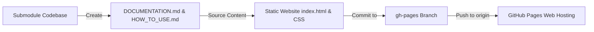

# Requirements

### Overview & Goals
The goal of this initiative is to establish a dedicated, static `gh-pages` branch for the `BlackboardSaveSystem` Git submodule repository (`https://github.com/ThiagoDAraujoS/BlackboardSaveSystem.git`). Hosting documentation on GitHub Pages maximizes utility for developers by providing an easily accessible, lightweight reference for installation, architecture, and API usage without requiring heavy CI build infrastructure or external server dependencies.

### Scope

#### In Scope
- Authoring comprehensive Markdown documentation (`DOCUMENTATION.md` and `HOW_TO_USE.md`) inside the `BlackboardSaveSystem` submodule repository.
- Creating an orphan `gh-pages` branch inside the `BlackboardSaveSystem` submodule repository.
- Designing a self-contained, clean static documentation web page (`index.html` with responsive CSS) built from `DOCUMENTATION.md` and `HOW_TO_USE.md`.
- Documenting complete C# API references for core classes: `Blackboard`, `SaveSystem`, `BlackboardScope`, `BlackboardClient`, `TrackedBehaviour`, `TrackedTransform`, and `UniqueId`.
- Providing standard UPM / Git submodule installation guides, assembly references (`BlackboardSaveSystem.Runtime`, `BlackboardSaveSystem.Editor`), and RAII lifecycle patterns.
- Pushing the `gh-pages` branch to `origin` and configuring GitHub Pages publishing settings.

#### Out of Scope
- Modifying host game source code in `Hollow Signal` or `Assets/Scripts/`.
- Setting up complex GitHub Actions Docker or DocFX build containers on remote servers.
- Adding third-party tracking scripts or external commercial analytics.

### User Stories
- **As a Unity developer**, I want to browse online documentation for `BlackboardSaveSystem` so that I can quickly learn how to install and integrate the package into new projects.
- **As a systems programmer**, I want a clear API reference for `Blackboard`, `SaveSystem`, and `BlackboardScope` so that I can properly leverage reference-counted save file lifecycles and component isolation.
- **As a maintainer**, I want a lightweight `gh-pages` branch that serves static documentation directly from GitHub without maintenance overhead or external build failures.

### Functional Requirements
1. **Markdown Source Documentation**:
   - `DOCUMENTATION.md`: Technical architecture breakdown (4-level partitioning: `fileName -> entityId -> componentId -> variableName -> value`), reference counting lifecycle (`AcquireFile`, `ReleaseFile`), and detailed C# API references (`Blackboard`, `SaveSystem`, `BlackboardScope`, `BlackboardClient`, `TrackedBehaviour`, `TrackedTransform`, `UniqueId`).
   - `HOW_TO_USE.md`: Step-by-step integration guide covering UPM / Git Submodule installation, setting up `BlackboardScope` components, binding variables with `Tracked<T>`, and managing save/load sessions.
2. **Orphan `gh-pages` Branch Isolation**: The `gh-pages` branch must be decoupled from `main` commit history, containing only static website assets and documentation files.
3. **Responsive Documentation UI**: Modern, accessible HTML5/CSS landing page (`index.html`) generated using `DOCUMENTATION.md` and `HOW_TO_USE.md` as reference content, complete with sidebar navigation, code syntax highlighting, and responsive layout.
4. **Git Remote Synchronization**: Instructions for pushing `gh-pages` to `origin` and enabling GitHub Pages under Repository Settings -> Pages.

# Technical Design

### Current Implementation
The `BlackboardSaveSystem` module resides in `Assets/ImportedToolsAndLibraries/BlackboardSaveSystem` and is registered as a Git submodule in `.gitmodules` pointing to `https://github.com/ThiagoDAraujoS/BlackboardSaveSystem.git`.

Key existing module files:
- `Runtime/Blackboard.cs`: Core dictionary storage and reference-counting logic (`_refCounts`).
- `Runtime/SaveSystem.cs`: File serialization and active session management.
- `Runtime/BlackboardScope.cs`: RAII component tracking required save files per scene/room.
- `Runtime/BlackboardClient.cs`: Handles entity-level state binding to `IBoundState` components.
- `Runtime/TrackedBehaviour.cs`, `TrackedTransform.cs`, `UniqueId.cs`: State components and GUID assignment.
- `Runtime/BlackboardSaveSystem.Runtime.asmdef` & `Editor/BlackboardSaveSystem.Editor.asmdef`: Unity assembly definitions.

Currently, the remote repository lacks a `gh-pages` branch and public web documentation.

### Key Decisions
1. **Static HTML/CSS vs DocFX CI Pipeline**:
   - *Decision*: Adopt a static `gh-pages` orphan branch containing lightweight static HTML/CSS rather than a DocFX CI pipeline.
   - *Rationale*: Eliminates external build pipeline dependencies, reduces setup friction, and guarantees 100% uptime and immediate rendering on GitHub Pages with zero CI maintenance.

2. **Orphan Git Branch Structure**:
   - *Decision*: Initialize `gh-pages` as a clean orphan branch (`git checkout --orphan gh-pages`).
   - *Rationale*: Keeps documentation assets completely separate from game code and UPM package releases, minimizing repo size for package consumers.

### Proposed Changes
1. **Create Markdown Documentation Suite (`main` branch)**:
   - Create `DOCUMENTATION.md` in `Assets/ImportedToolsAndLibraries/BlackboardSaveSystem/`:
     - System architecture & 4-level data partitioning (`fileName -> entityId -> componentId -> variableName -> value`).
     - Reference-counting save file lifecycle (`AcquireFile`, `ReleaseFile`).
     - Complete C# API reference: `Blackboard`, `SaveSystem`, `BlackboardScope`, `BlackboardClient`, `TrackedBehaviour`, `TrackedTransform`, `UniqueId`.
   - Create `HOW_TO_USE.md` in `Assets/ImportedToolsAndLibraries/BlackboardSaveSystem/`:
     - Package installation via UPM & Git Submodule.
     - Scene save scope configuration (`BlackboardScope`).
     - Entity tracking and custom component state (`TrackedBehaviour`, `Tracked<T>`).
     - Saving, loading, and active session directory lifecycle (`SaveSystem`).

2. **Initialize Orphan `gh-pages` Branch**:
   - Change directory into `Assets/ImportedToolsAndLibraries/BlackboardSaveSystem`.
   - Run `git checkout --orphan gh-pages` and remove tracked working tree entries (`git rm -rf .`).

3. **Create Static Documentation Web Site**:
   - Using `DOCUMENTATION.md` and `HOW_TO_USE.md` as content source, create `index.html`: Responsive single-page documentation app with navigation bar, sidebar table of contents, API references, and code syntax highlighting.
   - Add `css/style.css`: Clean dark technical theme optimized for code legibility.
   - Add `.nojekyll`: Prevent GitHub Pages from ignoring files with underscores or running Jekyll processing.

4. **Publish to GitHub Pages**:
   - Commit static documentation assets.
   - Push `gh-pages` branch to `origin`: `git push origin gh-pages`.
   - Switch submodule back to `main` branch.
   - Guide the user to configure GitHub Settings -> Pages -> Source: Deploy from a branch (`gh-pages` / `/ (root)`).

### File Structure
```
Assets/ImportedToolsAndLibraries/BlackboardSaveSystem/ (on branch main)
├── DOCUMENTATION.md
└── HOW_TO_USE.md

Assets/ImportedToolsAndLibraries/BlackboardSaveSystem/ (on branch gh-pages)
├── .nojekyll
├── index.html
└── css/
    └── style.css
```

### Architecture Diagram


### Risks & Mitigations
- **Submodule State Confusion**: Running git commands inside `Assets/ImportedToolsAndLibraries/BlackboardSaveSystem` affects the submodule repository state, not the main project repo.
  - *Mitigation*: Ensure all commands are executed strictly within the submodule directory or using `git -C Assets/ImportedToolsAndLibraries/BlackboardSaveSystem` explicit path flags, returning to `main` branch when finished.
- **Jekyll File Suppression**: GitHub Pages defaults to Jekyll processing, which can ignore files starting with underscores.
  - *Mitigation*: Include an empty `.nojekyll` file at the root of the `gh-pages` branch.

# Delivery Steps

### ✓ Step 1: Create DOCUMENTATION.md and HOW_TO_USE.md files in BlackboardSaveSystem submodule
Comprehensive Markdown documentation and step-by-step guides are created within the BlackboardSaveSystem submodule directory.

- Create `Assets/ImportedToolsAndLibraries/BlackboardSaveSystem/DOCUMENTATION.md` detailing:
  - System architecture and 4-level dictionary storage structure (`fileName -> entityId -> componentId -> variableName -> value`).
  - Reference counting lifecycle (`AcquireFile`, `ReleaseFile`, in-memory cache vs disk serialization).
  - Complete C# API references for `Blackboard`, `SaveSystem`, `BlackboardScope`, `BlackboardClient`, `TrackedBehaviour`, `TrackedTransform`, and `UniqueId`.
- Create `Assets/ImportedToolsAndLibraries/BlackboardSaveSystem/HOW_TO_USE.md` detailing:
  - UPM package & Git Submodule installation instructions.
  - Setting up scene save scopes with `BlackboardScope`.
  - Adding `TrackedBehaviour` and `Tracked<T>` fields to GameObjects.
  - Initializing active save sessions and serializing slots with `SaveSystem`.

### * Step 2: Initialize orphan gh-pages branch in BlackboardSaveSystem submodule
The submodule repository has a clean, decoupled orphan gh-pages branch ready for static documentation assets.

- Navigate into the submodule directory (`Assets/ImportedToolsAndLibraries/BlackboardSaveSystem`).
- Run `git checkout --orphan gh-pages` to create an independent branch with no prior commit history.
- Clear the working directory index (`git rm -rf .`) to ensure source code files do not clutter the documentation branch.
- Verify that `git status` confirms an empty working tree on branch `gh-pages`.

###   Step 3: Create static API documentation site and styling from Markdown source
The gh-pages branch contains a responsive static documentation site built using DOCUMENTATION.md and HOW_TO_USE.md.

- Add `.nojekyll` file at root to prevent GitHub Pages from processing assets through Jekyll.
- Create `index.html` containing:
  - Quick-start & UPM / Git Submodule installation instructions from `HOW_TO_USE.md`.
  - Component architecture overview & RAII file lifecycle explanation from `DOCUMENTATION.md`.
  - Complete C# API references for `Blackboard`, `SaveSystem`, `BlackboardScope`, `BlackboardClient`, `TrackedBehaviour`, `TrackedTransform`, and `UniqueId`.
  - Code examples for `AcquireFile`, `ReleaseFile`, and 4-level data partitioning.
- Create `css/style.css` providing a clean, responsive developer theme with side navigation and syntax-highlighted code blocks.

###   Step 4: Publish gh-pages branch and configure GitHub Pages deployment
The gh-pages branch is published to origin and step-by-step guidance is provided to enable GitHub Pages in repository settings.

- Stage all documentation assets (`git add .`).
- Commit the initial documentation suite (`git commit -m "Initial static API documentation & usage guide"`).
- Push the `gh-pages` branch to origin (`git push origin gh-pages`).
- Switch the submodule working tree back to `main` branch (`git checkout main`).
- Provide clear steps for enabling GitHub Pages under GitHub Repository Settings -> Pages -> Build and deployment (`Source: Deploy from a branch`, `Branch: gh-pages / (root)`).